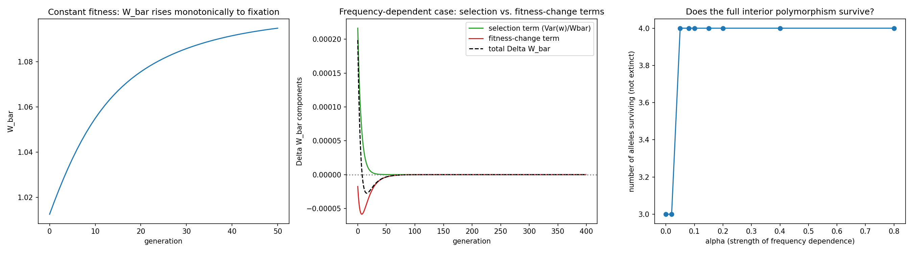

# Fisher's Fundamental Theorem of Natural Selection

What does "mean fitness always increases under selection" actually mean, exactly — and where does it stop
being true? An exact discrete-generation identity for the theorem's real, narrow claim, plus an exact
two-term decomposition (following George Price's 1972 clarification) showing precisely what the popular,
broader reading misses once fitness itself can change between generations.

## 1. Aim

Convert the historically disputed Fisher/Price distinction into a precise, checkable result: derive and
confirm an exact discrete-generation form of Fisher's theorem under constant fitness, then extend to
frequency-dependent fitness and confirm an exact decomposition of the *total* change in mean fitness into
the selection term Fisher's theorem describes and a second term it does not.

## 2. Objective

1. Build a discrete-generation, single-locus, multi-allele haploid selection model.
2. Derive and confirm the exact identity `Delta_W_bar = Var(w)/W_bar` under constant fitness.
3. Extend to frequency-dependent fitness and confirm an exact two-term decomposition of the total change in
   mean fitness.
4. Compare how mean fitness stops increasing under each scenario, and why.
5. Map how the strength of frequency-dependence affects whether a full genetic polymorphism survives.

## 3. Data fetch

None — and that's the right choice for this question: the claim being tested is a precise mathematical
identity about mean-fitness dynamics, so the real "data" is the model's own parameter space (allele
fitnesses, initial frequencies, strength of frequency-dependence), swept directly and checked against an
independently-derived symbolic solution — a stricter correctness standard for this specific claim than any
single real dataset could provide.

## 4. Data describe

Not applicable in the usual sense — the "data" is the model's own parameter space: allele fitnesses,
initial frequencies, and (in the frequency-dependent case) the strength of frequency-dependence, explored
via direct simulation and independent symbolic/analytical derivation.

## 5. Methods / Workflow

1. Implement the discrete-generation selection update and the mean-fitness/variance-in-fitness functions.
2. Under constant fitness, confirm the exact identity `Delta_W_bar = Var(w)/W_bar` for a single generation.
3. Run a multi-generation simulation under constant fitness; confirm non-decreasing mean fitness and
   convergence toward fixation of the fittest allele.
4. Introduce frequency-dependent fitness; confirm an exact two-term decomposition of the real total change
   in mean fitness for a single generation.
5. Run a multi-generation simulation under frequency-dependent selection; track both decomposition terms.
6. Directly compare the two scenarios: how does mean fitness stop increasing in each?
7. Sweep the strength of frequency-dependence and map whether a full polymorphism survives.
8. Export all results as CSV; plot the hero figures.

## 6. Results

**Exact-match checkpoints:** both core identities matched the real simulated numbers to floating-point
precision — `7.55e-17` for the constant-fitness identity, `6.59e-17` for the frequency-dependent two-term
decomposition — confirmed symbolically (SymPy, exact algebraic simplification to zero) and numerically.

**Constant-fitness case:** mean fitness rises monotonically (`W_bar: 1.0125 → 1.0948` over 50 generations)
and the population converges toward near-fixation of the fittest allele (`final p ≈ [0, 0.9999, 0, 0.0001]`).

**Frequency-dependent case (`alpha=0.3`):** the population converges to a genuine interior polymorphism
(`final p ≈ [0.1833, 0.25, 0.3167, 0.25]`, all 4 alleles present). Both the selection term and the
fitness-change term decay to zero together as equilibrium is approached — not one staying positive while the
other cancels it, which was the project's own original (and corrected) hypothesis.

**Mechanism contrast:** both scenarios end with `Var(w) ≈ 0`, but for different reasons — constant fitness
exhausts variance by eliminating alleles (1 allele survives); frequency-dependence exhausts variance by
equalizing realized fitness across alleles that all remain present (4 alleles survive).

**Alpha sweep:** a sharp survival threshold — at `alpha=0.0` and `alpha=0.02`, only 3 of 4 alleles survive;
from `alpha=0.05` onward, all 4 survive, matching an independently derivable closed-form feasibility
condition on the interior equilibrium.

## 7. Biology interpretation of results

Fisher's theorem's exact content is narrower than its popular reading: mean fitness only provably increases
due to the *selection* component alone, holding fitness values fixed. Once fitness itself can change — here,
because it's frequency-dependent — the total change decomposes exactly into that selection term plus a
second term the original theorem doesn't describe. The real payoff is the mechanism contrast this reveals:
negative frequency-dependent selection doesn't just slow mean fitness's rise, it substitutes a
diversity-preserving endpoint for the diversity-eliminating one that constant-fitness selection reaches —
a concrete, quantified version of why frequency-dependence is invoked as a real mechanism for maintaining
genetic polymorphism in real populations.

## 8. Learning through project

The most useful finding here was catching my own incorrect hypothesis before it reached the teaching
material: a plausible-sounding claim (the selection term stays positive at equilibrium while the total change
vanishes) turned out to be wrong once the real numbers were traced through — both terms vanish together,
because a true equilibrium requires all surviving alleles to have equal realized fitness, which drives the
variance itself to zero. The correct, more interesting finding — that variance gets exhausted by two
genuinely different mechanisms depending on the scenario — only emerged by running the real simulation
rather than reasoning qualitatively about what "should" happen.

## Caveats

This result holds for one specific, minimal model: a single haploid locus, linear negative
frequency-dependence, no dominance, no epistasis, no mutation, no migration. Diploid dominance effects
(which reintroduce a separate, classical complication to the naive reading of Fisher's theorem) and
nonlinear frequency-dependence (which could change the sharpness or location of the Step 7 survival
threshold) are both real, disclosed scope boundaries, not covered by this build's specific numbers.
